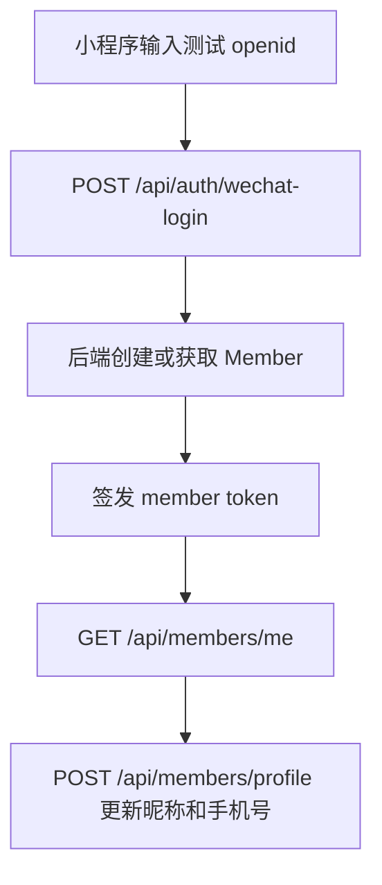
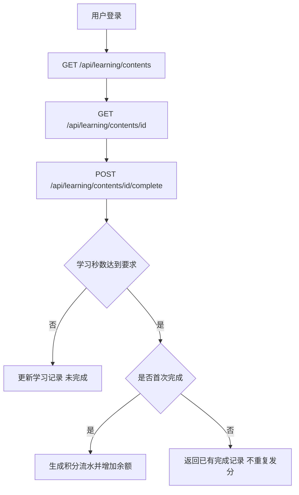
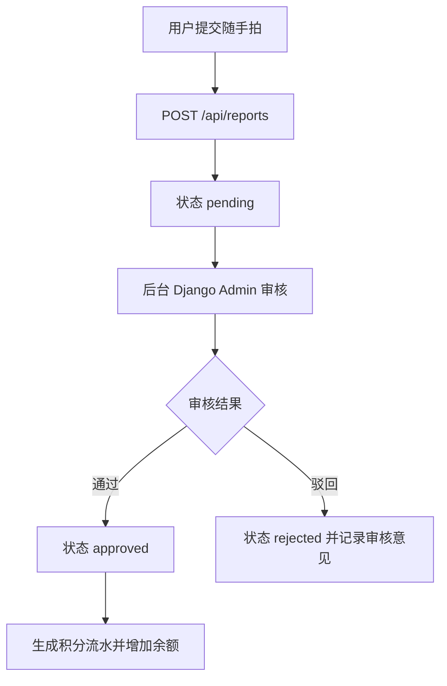
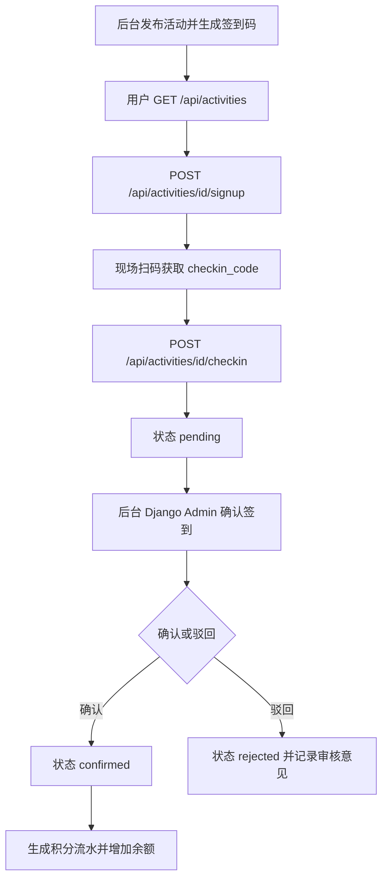
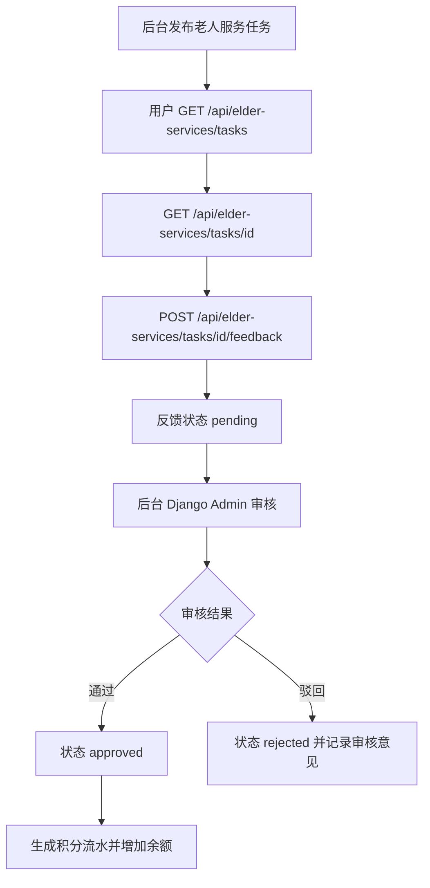
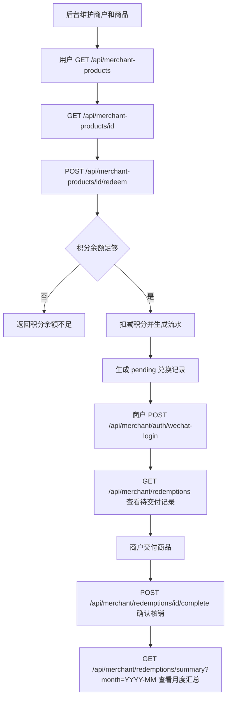

# 街道服务数字化操作系统 API 接口文档

本文档基于当前后端实现整理，适用于小程序用户端、商户端联调和一期验收。

## 1. 基础信息

- 服务前缀：`/api`
- 后台入口：`/admin/`
- API 文档：`/api/docs`
- OpenAPI Schema：`/api/openapi.json`
- 健康检查：`GET /api/health`
- 认证方式：`Authorization: Bearer <access_token>`
- 数据格式：`application/json`
- 分页参数：`page` 默认 `1`，`page_size` 默认 `20`、最大 `100`

### 1.1 成功响应

```json
{
  "code": 0,
  "message": "success",
  "data": {}
}
```

### 1.2 错误响应

```json
{
  "code": 40001,
  "message": "错误信息",
  "errors": null
}
```

常见状态：

| HTTP 状态 | 场景 |
| --- | --- |
| `400` | 请求参数错误、业务规则不满足 |
| `401` | 缺少 Bearer token、token 格式错误、token 过期、token 主体类型错误 |
| `403` | 用户或商户被禁用、不存在 |
| `404` | 资源不存在或当前用户无权访问该资源 |

### 1.3 通用分页响应

```json
{
  "code": 0,
  "message": "success",
  "data": {
    "items": [],
    "total": 0,
    "page": 1,
    "page_size": 20
  }
}
```

## 2. 认证与账号

### 2.1 用户登录

`POST /api/auth/wechat-login`

请求：

| 字段 | 类型 | 必填 | 说明 |
| --- | --- | --- | --- |
| `openid` | string | 否 | 开发期测试 openid；有值时创建或获取用户并签发 token |
| `code` | string | 否 | 微信临时登录 code；正式微信登录预留 |

开发期测试登录请求示例：

```json
{
  "openid": "test-openid"
}
```

正式微信登录请求形态：

```json
{
  "code": "wx-code"
}
```

响应 `data`：

| 字段 | 类型 | 说明 |
| --- | --- | --- |
| `access_token` | string | Bearer token |
| `token_type` | string | 固定为 `Bearer` |
| `expires_in` | integer | token 有效秒数 |
| `member.id` | integer | 用户 ID |
| `member.openid` | string | 用户 openid |
| `member.nickname` | string | 昵称 |
| `member.phone` | string | 手机号 |
| `member.is_active` | boolean | 是否启用 |

说明：

- `openid` 和 `code` 至少传一个。
- 传入 `openid` 时走开发期测试登录。
- 未配置 `WECHAT_MINIAPP_APPID` 或 `WECHAT_MINIAPP_SECRET` 时返回业务错误：`微信登录未配置，开发期请使用测试登录`。
- 一期保留 `code` 请求形态，不接入正式微信登录。

### 2.2 当前用户信息

`GET /api/members/me`

认证：用户 token。

请求参数：无路径参数、无查询参数、无请求体。

响应 `data`：

| 字段 | 类型 | 说明 |
| --- | --- | --- |
| `id` | integer | 用户 ID |
| `openid` | string | 用户 openid |
| `nickname` | string | 昵称 |
| `phone` | string | 手机号 |
| `is_active` | boolean | 是否启用 |

### 2.3 更新用户资料

`POST /api/members/profile`

认证：用户 token。

请求：

| 字段 | 类型 | 必填 | 说明 |
| --- | --- | --- | --- |
| `nickname` | string | 否 | 昵称，默认空字符串 |
| `phone` | string | 否 | 手机号，默认空字符串 |

请求示例：

```json
{
  "nickname": "张三",
  "phone": "13800000000"
}
```

响应 `data`：

| 字段 | 类型 | 说明 |
| --- | --- | --- |
| `id` | integer | 用户 ID |
| `openid` | string | 用户 openid |
| `nickname` | string | 更新后的昵称 |
| `phone` | string | 更新后的手机号 |
| `is_active` | boolean | 是否启用 |

## 3. 学习宣传

### 3.1 学习内容列表

`GET /api/learning/contents`

认证：用户 token。

查询参数：

| 字段 | 类型 | 必填 | 说明 |
| --- | --- | --- | --- |
| `page` | integer | 否 | 页码 |
| `page_size` | integer | 否 | 每页数量 |

响应 `data.items[]`：

| 字段 | 类型 | 说明 |
| --- | --- | --- |
| `id` | integer | 内容 ID |
| `title` | string | 标题 |
| `cover` | string | 封面图片 URL |
| `body` | string | 正文 |
| `points` | integer | 完成后发放积分 |
| `required_seconds` | integer | 要求学习秒数 |
| `is_active` | boolean | 是否上架 |

响应 `data` 分页字段：

| 字段 | 类型 | 说明 |
| --- | --- | --- |
| `items` | array | 学习内容列表 |
| `total` | integer | 总数量 |
| `page` | integer | 当前页码 |
| `page_size` | integer | 每页数量 |

### 3.2 学习内容详情

`GET /api/learning/contents/{content_id}`

认证：用户 token。

路径参数：

| 字段 | 类型 | 说明 |
| --- | --- | --- |
| `content_id` | integer | 内容 ID |

响应 `data`：

| 字段 | 类型 | 说明 |
| --- | --- | --- |
| `id` | integer | 内容 ID |
| `title` | string | 标题 |
| `cover` | string | 封面图片 URL |
| `body` | string | 正文 |
| `points` | integer | 完成后发放积分 |
| `required_seconds` | integer | 要求学习秒数 |
| `is_active` | boolean | 是否上架 |

### 3.3 完成学习

`POST /api/learning/contents/{content_id}/complete`

认证：用户 token。

路径参数：

| 字段 | 类型 | 说明 |
| --- | --- | --- |
| `content_id` | integer | 内容 ID |

请求：

| 字段 | 类型 | 必填 | 说明 |
| --- | --- | --- | --- |
| `learned_seconds` | integer | 是 | 已学习秒数，小于 0 时按 0 处理 |

响应 `data`：

| 字段 | 类型 | 说明 |
| --- | --- | --- |
| `id` | integer | 学习记录 ID |
| `content_id` | integer | 内容 ID |
| `learned_seconds` | integer | 已学习秒数 |
| `is_completed` | boolean | 是否完成 |
| `completed_at` | datetime/null | 完成时间 |
| `point_record_id` | integer/null | 关联积分流水 ID |

业务规则：

- 内容必须已上架。
- 同一用户同一内容只保留一条学习记录。
- `learned_seconds >= required_seconds` 时完成学习。
- 首次完成且内容积分大于 0 时发放积分。
- 重复完成不会重复发积分。

### 3.4 我的学习记录

`GET /api/learning/records`

认证：用户 token。

查询参数：

| 字段 | 类型 | 必填 | 说明 |
| --- | --- | --- | --- |
| `page` | integer | 否 | 页码 |
| `page_size` | integer | 否 | 每页数量 |

响应 `data.items[]`：

| 字段 | 类型 | 说明 |
| --- | --- | --- |
| `id` | integer | 学习记录 ID |
| `content_id` | integer | 内容 ID |
| `learned_seconds` | integer | 已学习秒数 |
| `is_completed` | boolean | 是否完成 |
| `completed_at` | datetime/null | 完成时间 |
| `point_record_id` | integer/null | 关联积分流水 ID |

响应 `data` 分页字段：

| 字段 | 类型 | 说明 |
| --- | --- | --- |
| `items` | array | 学习记录列表 |
| `total` | integer | 总数量 |
| `page` | integer | 当前页码 |
| `page_size` | integer | 每页数量 |

## 4. 随手拍上报

### 4.1 提交随手拍

`POST /api/reports`

认证：用户 token。

请求：

| 字段 | 类型 | 必填 | 说明 |
| --- | --- | --- | --- |
| `title` | string | 是 | 标题，不能为空 |
| `description` | string | 否 | 描述 |
| `image` | string | 否 | 图片路径或 URL |
| `location` | string | 否 | 位置 |

响应 `data`：

| 字段 | 类型 | 说明 |
| --- | --- | --- |
| `id` | integer | 上报 ID |
| `title` | string | 标题 |
| `description` | string | 描述 |
| `image` | string | 图片 URL |
| `location` | string | 位置 |
| `points` | integer | 审核通过后可发放积分 |
| `status` | string | `pending`、`approved`、`rejected` |
| `review_comment` | string | 审核意见 |
| `point_record_id` | integer/null | 关联积分流水 ID |
| `created_at` | datetime | 创建时间 |

### 4.2 我的随手拍

`GET /api/reports`

认证：用户 token。

查询参数：

| 字段 | 类型 | 必填 | 说明 |
| --- | --- | --- | --- |
| `page` | integer | 否 | 页码 |
| `page_size` | integer | 否 | 每页数量 |

响应 `data.items[]`：

| 字段 | 类型 | 说明 |
| --- | --- | --- |
| `id` | integer | 上报 ID |
| `title` | string | 标题 |
| `description` | string | 描述 |
| `image` | string | 图片 URL |
| `location` | string | 位置 |
| `points` | integer | 审核通过后可发放积分 |
| `status` | string | `pending`、`approved`、`rejected` |
| `review_comment` | string | 审核意见 |
| `point_record_id` | integer/null | 关联积分流水 ID |
| `created_at` | datetime | 创建时间 |

响应 `data` 分页字段：

| 字段 | 类型 | 说明 |
| --- | --- | --- |
| `items` | array | 随手拍列表 |
| `total` | integer | 总数量 |
| `page` | integer | 当前页码 |
| `page_size` | integer | 每页数量 |

### 4.3 随手拍详情

`GET /api/reports/{report_id}`

认证：用户 token。

路径参数：

| 字段 | 类型 | 说明 |
| --- | --- | --- |
| `report_id` | integer | 上报 ID，只能查看自己的上报 |

响应 `data`：

| 字段 | 类型 | 说明 |
| --- | --- | --- |
| `id` | integer | 上报 ID |
| `title` | string | 标题 |
| `description` | string | 描述 |
| `image` | string | 图片 URL |
| `location` | string | 位置 |
| `points` | integer | 审核通过后可发放积分 |
| `status` | string | `pending`、`approved`、`rejected` |
| `review_comment` | string | 审核意见 |
| `point_record_id` | integer/null | 关联积分流水 ID |
| `created_at` | datetime | 创建时间 |

后台流程：

- 后台人员在 Django Admin 审核随手拍。
- 审核通过：状态改为 `approved`，按上报积分发放积分并生成积分流水。
- 审核驳回：状态改为 `rejected`，必须填写审核意见，不发积分。
- 已审核记录不能再次审核。

## 5. 活动

### 5.1 活动列表

`GET /api/activities`

认证：用户 token。

查询参数：

| 字段 | 类型 | 必填 | 说明 |
| --- | --- | --- | --- |
| `page` | integer | 否 | 页码 |
| `page_size` | integer | 否 | 每页数量 |

响应 `data.items[]`：

| 字段 | 类型 | 说明 |
| --- | --- | --- |
| `id` | integer | 活动 ID |
| `title` | string | 标题 |
| `body` | string | 正文 |
| `location` | string | 地点 |
| `start_time` | datetime | 开始时间 |
| `end_time` | datetime | 结束时间 |
| `points` | integer | 签到确认后发放积分 |
| `status` | string | `draft`、`published`、`closed` |

响应 `data` 分页字段：

| 字段 | 类型 | 说明 |
| --- | --- | --- |
| `items` | array | 活动列表 |
| `total` | integer | 总数量 |
| `page` | integer | 当前页码 |
| `page_size` | integer | 每页数量 |

说明：接口仅返回已发布活动。

### 5.2 活动详情

`GET /api/activities/{activity_id}`

认证：用户 token。

路径参数：

| 字段 | 类型 | 说明 |
| --- | --- | --- |
| `activity_id` | integer | 活动 ID |

响应 `data`：

| 字段 | 类型 | 说明 |
| --- | --- | --- |
| `id` | integer | 活动 ID |
| `title` | string | 标题 |
| `body` | string | 正文 |
| `location` | string | 地点 |
| `start_time` | datetime | 开始时间 |
| `end_time` | datetime | 结束时间 |
| `points` | integer | 签到确认后发放积分 |
| `status` | string | `draft`、`published`、`closed` |

### 5.3 活动报名

`POST /api/activities/{activity_id}/signup`

认证：用户 token。

路径参数：

| 字段 | 类型 | 说明 |
| --- | --- | --- |
| `activity_id` | integer | 活动 ID |

请求体字段：无。

响应 `data`：

| 字段 | 类型 | 说明 |
| --- | --- | --- |
| `id` | integer | 报名 ID |
| `activity_id` | integer | 活动 ID |
| `created_at` | datetime | 报名时间 |

业务规则：

- 活动必须已发布。
- 同一用户同一活动不能重复报名。

### 5.4 活动扫码签到

`POST /api/activities/{activity_id}/checkin`

认证：用户 token。

路径参数：

| 字段 | 类型 | 说明 |
| --- | --- | --- |
| `activity_id` | integer | 活动 ID |

请求：

| 字段 | 类型 | 必填 | 说明 |
| --- | --- | --- | --- |
| `checkin_code` | string | 是 | 活动签到码 |

响应 `data`：

| 字段 | 类型 | 说明 |
| --- | --- | --- |
| `id` | integer | 签到 ID |
| `activity_id` | integer | 活动 ID |
| `status` | string | `pending`、`confirmed`、`rejected` |
| `review_comment` | string | 审核意见 |
| `point_record_id` | integer/null | 关联积分流水 ID |
| `created_at` | datetime | 签到提交时间 |

业务规则：

- 活动必须已发布。
- 用户必须已报名。
- 签到码必须与活动签到码一致。
- 同一用户同一活动不能重复签到。
- 签到成功后状态为 `pending`，等待后台确认。

### 5.5 我的报名

`GET /api/activities/my-signups`

认证：用户 token。

查询参数：

| 字段 | 类型 | 必填 | 说明 |
| --- | --- | --- | --- |
| `page` | integer | 否 | 页码 |
| `page_size` | integer | 否 | 每页数量 |

响应 `data.items[]`：

| 字段 | 类型 | 说明 |
| --- | --- | --- |
| `id` | integer | 报名 ID |
| `activity_id` | integer | 活动 ID |
| `created_at` | datetime | 报名时间 |

响应 `data` 分页字段：

| 字段 | 类型 | 说明 |
| --- | --- | --- |
| `items` | array | 报名记录列表 |
| `total` | integer | 总数量 |
| `page` | integer | 当前页码 |
| `page_size` | integer | 每页数量 |

后台流程：

- 活动由 Django Admin 创建和发布。
- 活动保存时生成签到码和签到二维码图片。
- 用户扫码后提交 `checkin_code`。
- 后台确认签到：状态改为 `confirmed`，按活动积分发放积分并生成积分流水。
- 后台驳回签到：状态改为 `rejected`，必须填写审核意见，不发积分。
- 已审核签到不能再次审核。

## 6. 助老服务

### 6.1 老人服务任务列表

`GET /api/elder-services/tasks`

认证：用户 token。

查询参数：

| 字段 | 类型 | 必填 | 说明 |
| --- | --- | --- | --- |
| `page` | integer | 否 | 页码 |
| `page_size` | integer | 否 | 每页数量 |

响应 `data.items[]`：

| 字段 | 类型 | 说明 |
| --- | --- | --- |
| `id` | integer | 任务 ID |
| `title` | string | 标题 |
| `description` | string | 描述 |
| `location` | string | 地点 |
| `points` | integer | 审核通过后发放积分 |
| `status` | string | `draft`、`published`、`closed` |

响应 `data` 分页字段：

| 字段 | 类型 | 说明 |
| --- | --- | --- |
| `items` | array | 老人服务任务列表 |
| `total` | integer | 总数量 |
| `page` | integer | 当前页码 |
| `page_size` | integer | 每页数量 |

说明：接口仅返回已发布任务。

### 6.2 老人服务任务详情

`GET /api/elder-services/tasks/{task_id}`

认证：用户 token。

路径参数：

| 字段 | 类型 | 说明 |
| --- | --- | --- |
| `task_id` | integer | 老人服务任务 ID |

响应 `data`：

| 字段 | 类型 | 说明 |
| --- | --- | --- |
| `id` | integer | 任务 ID |
| `title` | string | 标题 |
| `description` | string | 描述 |
| `location` | string | 地点 |
| `points` | integer | 审核通过后发放积分 |
| `status` | string | `draft`、`published`、`closed` |

### 6.3 提交服务反馈

`POST /api/elder-services/tasks/{task_id}/feedback`

认证：用户 token。

路径参数：

| 字段 | 类型 | 说明 |
| --- | --- | --- |
| `task_id` | integer | 老人服务任务 ID |

请求：

| 字段 | 类型 | 必填 | 说明 |
| --- | --- | --- | --- |
| `content` | string | 是 | 反馈内容，不能为空 |
| `image` | string | 否 | 图片路径或 URL |

响应 `data`：

| 字段 | 类型 | 说明 |
| --- | --- | --- |
| `id` | integer | 反馈 ID |
| `task_id` | integer | 任务 ID |
| `content` | string | 反馈内容 |
| `image` | string | 图片 URL |
| `status` | string | `pending`、`approved`、`rejected` |
| `review_comment` | string | 审核意见 |
| `point_record_id` | integer/null | 关联积分流水 ID |
| `created_at` | datetime | 创建时间 |

业务规则：

- 任务必须已发布。
- 同一用户同一任务不能重复提交反馈。
- 提交后状态为 `pending`。

### 6.4 我的服务反馈

`GET /api/elder-services/feedbacks`

认证：用户 token。

查询参数：

| 字段 | 类型 | 必填 | 说明 |
| --- | --- | --- | --- |
| `page` | integer | 否 | 页码 |
| `page_size` | integer | 否 | 每页数量 |

响应 `data.items[]`：

| 字段 | 类型 | 说明 |
| --- | --- | --- |
| `id` | integer | 反馈 ID |
| `task_id` | integer | 任务 ID |
| `content` | string | 反馈内容 |
| `image` | string | 图片 URL |
| `status` | string | `pending`、`approved`、`rejected` |
| `review_comment` | string | 审核意见 |
| `point_record_id` | integer/null | 关联积分流水 ID |
| `created_at` | datetime | 创建时间 |

响应 `data` 分页字段：

| 字段 | 类型 | 说明 |
| --- | --- | --- |
| `items` | array | 服务反馈列表 |
| `total` | integer | 总数量 |
| `page` | integer | 当前页码 |
| `page_size` | integer | 每页数量 |

后台流程：

- 老人服务任务由 Django Admin 创建和发布。
- 后台审核反馈。
- 审核通过：状态改为 `approved`，按任务积分发放积分并生成积分流水。
- 审核驳回：状态改为 `rejected`，必须填写审核意见，不发积分。
- 已审核反馈不能再次审核。

## 7. 积分

### 7.1 积分余额

`GET /api/points/balance`

认证：用户 token。

响应 `data`：

| 字段 | 类型 | 说明 |
| --- | --- | --- |
| `balance` | integer | 当前积分余额 |

### 7.2 积分明细

`GET /api/points/records`

认证：用户 token。

查询参数：

| 字段 | 类型 | 必填 | 说明 |
| --- | --- | --- | --- |
| `page` | integer | 否 | 页码 |
| `page_size` | integer | 否 | 每页数量 |

响应 `data.items[]`：

| 字段 | 类型 | 说明 |
| --- | --- | --- |
| `id` | integer | 积分流水 ID |
| `amount` | integer | 积分变动值，增加为正数、扣减为负数 |
| `change_type` | string | `income` 或 `expense` |
| `source_type` | string | 来源类型 |
| `source_id` | string | 来源业务 ID |
| `reason` | string | 变动原因 |
| `created_at` | datetime | 创建时间 |

响应 `data` 分页字段：

| 字段 | 类型 | 说明 |
| --- | --- | --- |
| `items` | array | 积分明细列表 |
| `total` | integer | 总数量 |
| `page` | integer | 当前页码 |
| `page_size` | integer | 每页数量 |

`source_type` 取值：

- `learning`
- `report`
- `activity`
- `elder_service`
- `manual`
- `product_redemption`

积分规则：

- 所有积分增加或扣减都会生成 `PointRecord`。
- 积分扣减前会校验余额，余额不足时拒绝。
- 后台人工加分必须填写原因并记录操作人。

## 8. 商品兑换 用户端

### 8.1 可兑换商品列表

`GET /api/merchant-products`

认证：用户 token。

查询参数：

| 字段 | 类型 | 必填 | 说明 |
| --- | --- | --- | --- |
| `page` | integer | 否 | 页码 |
| `page_size` | integer | 否 | 每页数量 |

响应 `data.items[]`：

| 字段 | 类型 | 说明 |
| --- | --- | --- |
| `id` | integer | 商品 ID |
| `merchant_id` | integer | 商户 ID |
| `merchant_name` | string | 商户名称 |
| `name` | string | 商品名称 |
| `image` | string | 商品图片 URL |
| `description` | string | 商品说明 |
| `points_required` | integer | 兑换所需积分 |
| `is_active` | boolean | 是否上架 |
| `created_at` | datetime | 创建时间 |

响应 `data` 分页字段：

| 字段 | 类型 | 说明 |
| --- | --- | --- |
| `items` | array | 可兑换商品列表 |
| `total` | integer | 总数量 |
| `page` | integer | 当前页码 |
| `page_size` | integer | 每页数量 |

说明：接口仅返回上架商品。

### 8.2 可兑换商品详情

`GET /api/merchant-products/{product_id}`

认证：用户 token。

路径参数：

| 字段 | 类型 | 说明 |
| --- | --- | --- |
| `product_id` | integer | 商品 ID |

响应 `data`：

| 字段 | 类型 | 说明 |
| --- | --- | --- |
| `id` | integer | 商品 ID |
| `merchant_id` | integer | 商户 ID |
| `merchant_name` | string | 商户名称 |
| `name` | string | 商品名称 |
| `image` | string | 商品图片 URL |
| `description` | string | 商品说明 |
| `points_required` | integer | 兑换所需积分 |
| `is_active` | boolean | 是否上架 |
| `created_at` | datetime | 创建时间 |

### 8.3 使用积分兑换商品

`POST /api/merchant-products/{product_id}/redeem`

认证：用户 token。

路径参数：

| 字段 | 类型 | 说明 |
| --- | --- | --- |
| `product_id` | integer | 商品 ID |

请求体字段：无。

响应 `data`：

| 字段 | 类型 | 说明 |
| --- | --- | --- |
| `id` | integer | 兑换记录 ID |
| `merchant_id` | integer | 商户 ID |
| `product_id` | integer | 商品 ID |
| `product_name` | string | 商品名称 |
| `member_id` | integer | 用户 ID |
| `points_spent` | integer | 消耗积分 |
| `status` | string | `pending` 或 `completed` |
| `created_at` | datetime | 创建时间 |

业务规则：

- 商品必须上架。
- 商品所需积分必须大于 0。
- 用户积分余额必须足够。
- 兑换成功后扣减积分并生成积分流水。
- 兑换记录默认状态为 `pending`。
- 一期不提供商户确认领取接口，`completed` 由 Django Admin 后台手动标记。

### 8.4 我的商品兑换记录

`GET /api/product-redemptions`

认证：用户 token。

查询参数：

| 字段 | 类型 | 必填 | 说明 |
| --- | --- | --- | --- |
| `page` | integer | 否 | 页码 |
| `page_size` | integer | 否 | 每页数量 |

响应 `data.items[]`：

| 字段 | 类型 | 说明 |
| --- | --- | --- |
| `id` | integer | 兑换记录 ID |
| `merchant_id` | integer | 商户 ID |
| `product_id` | integer | 商品 ID |
| `product_name` | string | 商品名称 |
| `member_id` | integer | 用户 ID |
| `points_spent` | integer | 消耗积分 |
| `status` | string | `pending` 或 `completed` |
| `created_at` | datetime | 创建时间 |

响应 `data` 分页字段：

| 字段 | 类型 | 说明 |
| --- | --- | --- |
| `items` | array | 商品兑换记录列表 |
| `total` | integer | 总数量 |
| `page` | integer | 当前页码 |
| `page_size` | integer | 每页数量 |

## 9. 商户端

### 9.1 商户登录

`POST /api/merchant/auth/wechat-login`

请求：

| 字段 | 类型 | 必填 | 说明 |
| --- | --- | --- | --- |
| `openid` | string | 否 | 开发期测试商户 openid；有值时创建或获取商户并签发 token |
| `code` | string | 否 | 微信临时登录 code；正式微信登录预留 |

开发期测试登录请求示例：

```json
{
  "openid": "merchant-openid"
}
```

正式微信登录请求形态：

```json
{
  "code": "wx-code"
}
```

响应 `data`：

| 字段 | 类型 | 说明 |
| --- | --- | --- |
| `access_token` | string | 商户 Bearer token |
| `token_type` | string | 固定为 `Bearer` |
| `expires_in` | integer | token 有效秒数 |
| `merchant.id` | integer | 商户 ID |
| `merchant.openid` | string | 商户 openid |
| `merchant.name` | string | 商户名称 |
| `merchant.contact_name` | string | 联系人 |
| `merchant.phone` | string | 手机号 |
| `merchant.address` | string | 经营地址 |
| `merchant.is_active` | boolean | 是否启用 |

说明：

- `openid` 和 `code` 至少传一个。
- 传入 `openid` 时走开发期测试登录。
- 未配置 `WECHAT_MINIAPP_APPID` 或 `WECHAT_MINIAPP_SECRET` 时返回业务错误：`商户微信登录未配置，开发期请使用测试登录`。
- 一期保留 `code` 请求形态，不接入正式微信登录。

### 9.2 当前商户信息

`GET /api/merchant/me`

认证：商户 token。

请求参数：无路径参数、无查询参数、无请求体。

响应 `data`：

| 字段 | 类型 | 说明 |
| --- | --- | --- |
| `id` | integer | 商户 ID |
| `openid` | string | 商户 openid |
| `name` | string | 商户名称 |
| `contact_name` | string | 联系人 |
| `phone` | string | 手机号 |
| `address` | string | 经营地址 |
| `is_active` | boolean | 是否启用 |

### 9.3 商户商品兑换记录

`GET /api/merchant/redemptions`

认证：商户 token。

查询参数：

| 字段 | 类型 | 必填 | 说明 |
| --- | --- | --- | --- |
| `page` | integer | 否 | 页码 |
| `page_size` | integer | 否 | 每页数量 |

响应 `data.items[]`：

| 字段 | 类型 | 说明 |
| --- | --- | --- |
| `id` | integer | 兑换记录 ID |
| `merchant_id` | integer | 商户 ID |
| `product_id` | integer | 商品 ID |
| `product_name` | string | 商品名称 |
| `member_id` | integer | 用户 ID |
| `points_spent` | integer | 消耗积分 |
| `status` | string | `pending` 或 `completed` |
| `created_at` | datetime | 创建时间 |

响应 `data` 分页字段：

| 字段 | 类型 | 说明 |
| --- | --- | --- |
| `items` | array | 当前商户商品兑换记录列表 |
| `total` | integer | 总数量 |
| `page` | integer | 当前页码 |
| `page_size` | integer | 每页数量 |

### 9.4 商户确认商品交付

`POST /api/merchant/redemptions/{redemption_id}/complete`

认证：商户 token。

路径参数：

| 字段 | 类型 | 说明 |
| --- | --- | --- |
| `redemption_id` | integer | 商品兑换记录 ID |

请求参数：无查询参数、无请求体。

响应 `data`：

| 字段 | 类型 | 说明 |
| --- | --- | --- |
| `id` | integer | 兑换记录 ID |
| `merchant_id` | integer | 商户 ID |
| `product_id` | integer | 商品 ID |
| `product_name` | string | 商品名称 |
| `member_id` | integer | 用户 ID |
| `points_spent` | integer | 消耗积分 |
| `status` | string | 固定返回 `completed` |
| `created_at` | datetime | 创建时间 |

业务规则：

- 只能确认当前登录商户自己的兑换记录。
- 商户向用户交付商品后调用本接口完成核销。
- 已完成的兑换记录不能重复确认。
- 访问其他商户的兑换记录返回 `404`。

### 9.5 商户月度兑换汇总

`GET /api/merchant/redemptions/summary`

认证：商户 token。

查询参数：

| 字段 | 类型 | 必填 | 说明 |
| --- | --- | --- | --- |
| `month` | string | 是 | 月份，格式 `YYYY-MM` |

响应 `data`：

| 字段 | 类型 | 说明 |
| --- | --- | --- |
| `month` | string | 月份 |
| `redemption_count` | integer | 兑换笔数 |
| `product_count` | integer | 兑换商品种类数 |
| `points_total` | integer | 消耗积分合计 |

错误规则：

- `month` 格式不是 `YYYY-MM` 时返回业务错误：`月份格式必须为 YYYY-MM`。

## 10. 健康检查

### 10.1 服务健康检查

`GET /api/health`

认证：无。

请求参数：无路径参数、无查询参数、无请求体。

响应 `data`：

| 字段 | 类型 | 说明 |
| --- | --- | --- |
| `status` | string | 服务状态，正常时为 `ok` |

## 11. 业务流程

### 11.1 用户登录与资料维护



### 11.2 学习积分流程



### 11.3 随手拍审核积分流程



### 11.4 活动报名签到流程



### 11.5 助老服务反馈流程



### 11.6 商品兑换与商户查询流程


