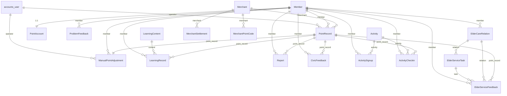

# 数据库设计文档

## 1. 概述

系统使用 **PostgreSQL 17** 作为主数据库。数据模型基于 Django ORM 定义，共涉及 **12 个应用**、**20 个模型**。

核心设计思路：

- `Member`（用户）是数据中枢，几乎所有业务模型都以 FK 指向用户。
- `PointRecord`（积分流水）是统一的积分变动记录，所有积分增减均通过 `points/services.py` 的 `add_points` / `deduct_points` 事务性写入。
- 各业务模型通过 `point_record` FK 回链到对应的积分流水，形成审计闭环。
- `Member`（微信用户）与 `accounts.User`（后台管理员）是两套独立的认证体系，分别通过 openid 和 username 标识。

## 2. 模型总览

| 应用 | 模型 | 说明 | 表名 |
|------|------|------|------|
| accounts | User | 后台管理员账号 | accounts_user |
| members | Member | 微信用户（居民/小哥） | members_member |
| learning | LearningContent | 学习内容 | learning_content |
| learning | LearningRecord | 学习记录 | learning_record |
| reports | Report | 随手拍上报 | reports_report |
| civic_feedbacks | CivicFeedback | 社情民意 | civic_feedback |
| problem_feedbacks | ProblemFeedback | 问题反馈 | problem_feedback |
| activities | Activity | 活动 | activities_activity |
| activities | ActivitySignup | 活动报名 | activities_signup |
| activities | ActivityCheckin | 活动签到 | activities_checkin |
| elder_services | ElderCareRelation | 小哥-老人对口关系 | elder_care_relation |
| elder_services | ElderServiceTask | 老人服务任务 | elder_service_task |
| elder_services | ElderServiceFeedback | 老人服务反馈 | elder_service_feedback |
| points | PointAccount | 积分账户 | points_account |
| points | PointRecord | 积分流水 | points_record |
| points | PointExchangeRule | 积分兑换比例 | points_exchange_rule |
| points | ManualPointAdjustment | 人工加分 | points_manual_adjustment |
| merchants | Merchant | 商户 | merchants_merchant |
| merchants | MerchantSettlement | 商户结算记录 | merchant_settlement |
| merchants | MerchantPointCode | 商户固定积分码 | merchant_point_code |

## 3. ER 关系图

## 4. 模型详细定义

### 4.1 accounts.User — 后台管理员账号

继承 `AbstractUser`，作为 Django Admin 和后台管理 API 的登录主体。

| 字段 | 类型 | 约束 | 说明 |
|------|------|------|------|
| username | CharField | inherited, unique | 用户名 |
| password | CharField | inherited | 密码（哈希） |
| is_staff | BooleanField | inherited, default False | 是否可登录 Admin |
| is_active | BooleanField | inherited, default True | 是否启用 |
| is_backend_manager | BooleanField | default=False | 是否为后台业务管理员 |

**业务逻辑**：`save()` 中若 `is_backend_manager=True`，自动设置 `is_staff=True`，确保可登录 Django Admin。

### 4.2 members.Member — 微信用户

| 字段 | 类型 | 约束 | 说明 |
|------|------|------|------|
| openid | CharField(128) | unique | 微信 OpenID |
| nickname | CharField(64) | blank | 昵称 |
| phone | CharField(20) | blank | 手机号 |
| real_name | CharField(50) | blank | 真实姓名 |
| identity_type | CharField(32) | choices, default normal_user | 身份类型：普通用户 / 小哥 |
| audit_status | CharField(20) | choices, default none | 审核状态：未提交 / 待审核 / 已通过 / 已驳回 |
| audit_remark | CharField(255) | blank | 审核说明 |
| audit_submitted_at | DateTimeField | null | 最近提交审核时间 |
| is_active | BooleanField | default True | 是否启用 |
| created_at | DateTimeField | auto_now_add | 创建时间 |

**枚举值**：

- `IdentityType`: `normal_user`（普通用户）、`courier`（小哥）
- `AuditStatus`: `none`（未提交）、`pending`（待审核）、`approved`（已通过）、`rejected`（已驳回）

### 4.3 learning.LearningContent — 学习内容

| 字段 | 类型 | 约束 | 说明 |
|------|------|------|------|
| title | CharField(120) | | 标题 |
| cover | ImageField | blank, upload_to=learning/covers/ | 封面图 |
| image | ImageField | blank, upload_to=learning/images/ | 内容图片 |
| video | FileField | blank, upload_to=learning/videos/ | 视频文件 |
| body | TextField | blank | 正文 |
| content_type | CharField(20) | choices, default article | 内容类型 |
| points | PositiveIntegerField | default 0 | 积分值 |
| required_seconds | PositiveIntegerField | default 60 | 要求学习秒数 |
| is_active | BooleanField | default True | 是否上架 |
| created_at | DateTimeField | auto_now_add | 创建时间 |

**枚举值**：`ContentType`: `article`（图文文章）、`image`（图片内容）、`video`（视频内容）

### 4.4 learning.LearningRecord — 学习记录

| 字段 | 类型 | 约束 | 说明 |
|------|------|------|------|
| member | FK → Member | CASCADE | 用户 |
| content | FK → LearningContent | CASCADE | 学习内容 |
| learned_seconds | PositiveIntegerField | default 0 | 学习秒数 |
| is_completed | BooleanField | default False | 是否完成 |
| completed_at | DateTimeField | null | 完成时间 |
| point_record | FK → PointRecord | SET_NULL, null | 关联积分流水 |
| created_at | DateTimeField | auto_now_add | 创建时间 |
| updated_at | DateTimeField | auto_now | 更新时间 |

**约束**：`unique_together = (member, content)` — 同一用户对同一内容仅一条记录。

### 4.5 reports.Report — 随手拍上报

| 字段 | 类型 | 约束 | 说明 |
|------|------|------|------|
| member | FK → Member | CASCADE | 用户 |
| category_code | CharField(32) | choices, default other | 分类编码 |
| title | CharField(120) | | 标题 |
| description | TextField | blank | 描述 |
| image | ImageField | blank, upload_to=reports/ | 图片 |
| image_urls | JSONField | default list | 图片URL列表 |
| location | CharField(255) | blank | 位置 |
| points | PositiveIntegerField | default 5 | 积分值 |
| status | CharField(20) | choices, default pending | 状态 |
| review_comment | CharField(255) | blank | 审核意见 |
| point_record | FK → PointRecord | SET_NULL, null | 关联积分流水 |
| created_at | DateTimeField | auto_now_add | 创建时间 |
| updated_at | DateTimeField | auto_now | 更新时间 |

**枚举值**：

- `CategoryCode`: `road_light`（路灯损坏）、`well_cover`（井盖问题）、`water_leak`（管道漏水）、`road_damage`（道路破损）、`tree_fall`（树木倒伏）、`other`（其他）
- `Status`: `pending`（待审核）、`approved`（已通过）、`rejected`（已驳回）

### 4.6 civic_feedbacks.CivicFeedback — 社情民意

| 字段 | 类型 | 约束 | 说明 |
|------|------|------|------|
| member | FK → Member | CASCADE | 用户 |
| title | CharField(120) | | 标题 |
| content | TextField | | 内容 |
| material_urls | JSONField | default list | 材料图片URL列表 |
| status | CharField(20) | choices, default submitted | 状态 |
| reply | TextField | blank | 处理回复 |
| points | PositiveIntegerField | default 0 | 积分值 |
| point_record | FK → PointRecord | SET_NULL, null | 关联积分流水 |
| created_at | DateTimeField | auto_now_add | 创建时间 |
| updated_at | DateTimeField | auto_now | 更新时间 |

**枚举值**：`Status`: `submitted`（已提交）、`accepted`（已采纳）、`rejected`（已驳回）

### 4.7 problem_feedbacks.ProblemFeedback — 问题反馈

| 字段 | 类型 | 约束 | 说明 |
|------|------|------|------|
| member | FK → Member | CASCADE | 用户 |
| title | CharField(120) | | 标题 |
| content | TextField | | 内容 |
| status | CharField(20) | choices, default submitted | 状态 |
| reply | TextField | blank | 回复 |
| replied_at | DateTimeField | null | 回复时间 |
| created_at | DateTimeField | auto_now_add | 创建时间 |
| updated_at | DateTimeField | auto_now | 更新时间 |

**枚举值**：`Status`: `submitted`（已提交）、`processing`（处理中）、`replied`（已回复）、`closed`（已关闭）

### 4.8 activities.Activity — 活动

| 字段 | 类型 | 约束 | 说明 |
|------|------|------|------|
| title | CharField(120) | | 标题 |
| body | TextField | blank | 正文 |
| location | CharField(255) | blank | 地点 |
| start_time | DateTimeField | | 开始时间 |
| end_time | DateTimeField | | 结束时间 |
| points | PositiveIntegerField | default 0 | 积分值 |
| status | CharField(20) | choices, default draft | 状态 |
| checkin_code | CharField(64) | unique, blank | 签到码（UUID自动生成） |
| checkin_qr_image | ImageField | blank, upload_to=activities/qrcodes/ | 签到二维码图片 |
| created_at | DateTimeField | auto_now_add | 创建时间 |

**枚举值**：`Status`: `draft`（草稿）、`published`（已发布）、`closed`（已关闭）

**业务逻辑**：`save()` 中自动生成 `checkin_code`（uuid4 hex），并使用 `qrcode` 库生成签到二维码 PNG 图片。

### 4.9 activities.ActivitySignup — 活动报名

| 字段 | 类型 | 约束 | 说明 |
|------|------|------|------|
| member | FK → Member | CASCADE | 用户 |
| activity | FK → Activity | CASCADE | 活动 |
| created_at | DateTimeField | auto_now_add | 报名时间 |

**约束**：`unique_together = (member, activity)` — 同一用户对同一活动仅可报名一次。

### 4.10 activities.ActivityCheckin — 活动签到

| 字段 | 类型 | 约束 | 说明 |
|------|------|------|------|
| member | FK → Member | CASCADE | 用户 |
| activity | FK → Activity | CASCADE | 活动 |
| status | CharField(20) | choices, default pending | 状态 |
| review_comment | CharField(255) | blank | 审核意见 |
| point_record | FK → PointRecord | SET_NULL, null | 关联积分流水 |
| created_at | DateTimeField | auto_now_add | 签到时间 |
| updated_at | DateTimeField | auto_now | 更新时间 |

**约束**：`unique_together = (member, activity)` — 同一用户对同一活动仅可签到一次。

**枚举值**：`Status`: `pending`（待确认）、`confirmed`（已确认）、`rejected`（已驳回）

### 4.11 elder_services.ElderCareRelation — 小哥-老人对口关系

| 字段 | 类型 | 约束 | 说明 |
|------|------|------|------|
| member | FK → Member | CASCADE | 小哥（用户） |
| elder_name | CharField(80) | | 老人称呼 |
| elder_address | CharField(255) | | 老人地址 |
| frequency | CharField(80) | blank | 服务频次 |
| is_active | BooleanField | default True | 是否有效 |
| created_at | DateTimeField | auto_now_add | 创建时间 |
| updated_at | DateTimeField | auto_now | 更新时间 |

### 4.12 elder_services.ElderServiceTask — 老人服务任务

| 字段 | 类型 | 约束 | 说明 |
|------|------|------|------|
| title | CharField(120) | | 标题 |
| relation | FK → ElderCareRelation | PROTECT, null | 对口关系 |
| description | TextField | blank | 描述 |
| location | CharField(255) | blank | 地点 |
| points | PositiveIntegerField | default 0 | 积分值 |
| status | CharField(20) | choices, default draft | 状态 |
| created_at | DateTimeField | auto_now_add | 创建时间 |

**枚举值**：`Status`: `draft`（草稿）、`published`（已发布）、`closed`（已关闭）

### 4.13 elder_services.ElderServiceFeedback — 老人服务反馈

| 字段 | 类型 | 约束 | 说明 |
|------|------|------|------|
| member | FK → Member | CASCADE | 用户 |
| relation | FK → ElderCareRelation | PROTECT, null | 对口关系 |
| task | FK → ElderServiceTask | CASCADE | 任务 |
| content | TextField | | 反馈内容 |
| image | ImageField | blank, upload_to=elder-services/feedbacks/ | 图片 |
| image_urls | JSONField | default list | 图片URL列表 |
| status | CharField(20) | choices, default pending | 状态 |
| review_comment | CharField(255) | blank | 审核意见 |
| point_record | FK → PointRecord | SET_NULL, null | 关联积分流水 |
| created_at | DateTimeField | auto_now_add | 创建时间 |
| updated_at | DateTimeField | auto_now | 更新时间 |

**枚举值**：`Status`: `pending`（待审核）、`approved`（已通过）、`rejected`（已驳回）

### 4.14 points.PointAccount — 积分账户

| 字段 | 类型 | 约束 | 说明 |
|------|------|------|------|
| member | OneToOne → Member | CASCADE | 用户（1:1） |
| balance | IntegerField | default 0 | 余额 |

### 4.15 points.PointRecord — 积分流水

| 字段 | 类型 | 约束 | 说明 |
|------|------|------|------|
| member | FK → Member | CASCADE | 用户 |
| amount | IntegerField | | 积分变动值（正数收入，负数扣减） |
| change_type | CharField(20) | choices | 变动类型 |
| source_type | CharField(32) | choices | 来源类型 |
| source_id | CharField(64) | blank | 来源ID |
| reason | CharField(255) | | 原因 |
| balance_after | IntegerField | null | 变动后余额 |
| merchant | FK → Merchant | SET_NULL, null | 商户（商户支付时关联） |
| yuan_amount | DecimalField(10,2) | null | 折算金额 |
| request_no | CharField(64) | blank | 请求号（幂等用） |
| operator | FK → User | SET_NULL, null | 操作人 |
| created_at | DateTimeField | auto_now_add | 创建时间 |

**枚举值**：

- `ChangeType`: `income`（收入）、`expense`（扣减）
- `SourceType`: `learning`（学习）、`report`（随手拍）、`activity`（活动）、`elder_service`（老人服务）、`civic_feedback`（社情民意）、`manual`（人工）、`merchant_payment`（商户积分支付）

**约束**：`UniqueConstraint(fields=["merchant", "request_no"], condition=~Q(request_no=""), name="uniq_merchant_point_record_request_no")` — 商户支付幂等：同一商户 + 同一 request_no 不重复创建流水。

### 4.16 points.PointExchangeRule — 积分兑换比例

| 字段 | 类型 | 约束 | 说明 |
|------|------|------|------|
| points_per_yuan | PositiveIntegerField | | 每元所需积分 |
| is_active | BooleanField | default True | 是否启用 |
| updated_at | DateTimeField | auto_now | 更新时间 |

### 4.17 points.ManualPointAdjustment — 人工加分

| 字段 | 类型 | 约束 | 说明 |
|------|------|------|------|
| member | FK → Member | CASCADE | 用户 |
| amount | PositiveIntegerField | | 积分值 |
| reason | CharField(255) | | 原因 |
| operator | FK → User | PROTECT | 操作人 |
| point_record | OneToOne → PointRecord | PROTECT, null | 积分流水 |
| created_at | DateTimeField | auto_now_add | 创建时间 |

**业务逻辑**：`save()` 中首次创建时，懒导入 `manual_add_points` 服务函数，自动创建关联的 `PointRecord`。

### 4.18 merchants.Merchant — 商户

| 字段 | 类型 | 约束 | 说明 |
|------|------|------|------|
| openid | CharField(128) | unique | 微信 OpenID |
| name | CharField(100) | | 商户名称 |
| contact_name | CharField(50) | blank | 联系人 |
| phone | CharField(20) | blank | 手机号 |
| address | CharField(255) | blank | 经营地址 |
| is_active | BooleanField | default True | 是否启用 |
| created_at | DateTimeField | auto_now_add | 创建时间 |

### 4.19 merchants.MerchantSettlement — 商户结算记录

| 字段 | 类型 | 约束 | 说明 |
|------|------|------|------|
| merchant | FK → Merchant | CASCADE | 商户 |
| period_type | CharField(20) | choices | 周期类型 |
| period_label | CharField(32) | | 周期标签 |
| date_from | DateField | | 开始日期 |
| date_to | DateField | | 结束日期 |
| record_count | PositiveIntegerField | default 0 | 流水数 |
| total_points | PositiveIntegerField | default 0 | 总积分 |
| total_yuan_amount | DecimalField(12,2) | default 0 | 总金额 |
| status | CharField(20) | choices, default pending | 状态 |
| processed_at | DateTimeField | null | 处理时间 |
| processor_name | CharField(80) | blank | 处理人 |
| remark | TextField | blank | 备注 |
| created_at | DateTimeField | auto_now_add | 创建时间 |
| updated_at | DateTimeField | auto_now | 更新时间 |

**枚举值**：

- `PeriodType`: `month`（自然月）、`custom`（自定义）
- `Status`: `pending`（待处理）、`processed`（已处理）

### 4.20 merchants.MerchantPointCode — 商户固定积分码

| 字段 | 类型 | 约束 | 说明 |
|------|------|------|------|
| merchant | FK → Merchant | CASCADE | 商户 |
| points | PositiveIntegerField | | 固定积分面额 |
| code | CharField(64) | unique | 二维码标识（UUID自动生成） |
| is_active | BooleanField | default True | 是否启用 |
| remark | CharField(255) | blank | 备注 |
| created_at | DateTimeField | auto_now_add | 创建时间 |
| updated_at | DateTimeField | auto_now | 更新时间 |

## 5. 设计要点

### 5.1 on_delete 策略

| 策略 | 使用场景 | 说明 |
|------|----------|------|
| CASCADE | Member → 业务模型 | 用户删除时级联删除所有业务数据 |
| SET_NULL | 业务模型 → PointRecord | 积分流水不随业务记录删除而丢失 |
| PROTECT | ManualPointAdjustment.operator/point_record | 防止有调分记录的管理员/流水被删除 |
| PROTECT | ElderServiceTask.relation | 防止有任务的对口关系被删除 |

### 5.2 幂等控制

`PointRecord` 表上的 `UniqueConstraint(fields=["merchant", "request_no"], condition=~Q(request_no=""))` 是商户支付幂等的核心保障。前端在发起支付时生成 `request_no`，重试时携带相同的 `request_no`，数据库层面保证同一商户不会因同一 `request_no` 重复扣分。

### 5.3 积分流水统一模型

所有积分变动（学习、上报、活动、老人服务、社情民意、人工调分、商户支付）共用一张 `PointRecord` 表，通过 `source_type` 区分来源，`source_id` 关联具体业务记录。`balance_after` 字段记录每次变动后的余额快照，便于审计追溯。

### 5.4 多图存储模式

`Report`、`ElderServiceFeedback`、`CivicFeedback` 等模型同时使用 `ImageField`（单图）和 `JSONField`（多图URL列表）两种方式。`image_urls` / `material_urls` 字段存储前端通过通用上传接口上传后返回的 URL 列表，支持一次提交多张图片。

### 5.5 账户懒创建

`PointAccount` 不在用户注册时创建，而是在首次积分变动时通过 `get_or_create_account(member)` 懒创建。`add_points` 和 `deduct_points` 均使用 `select_for_update` 对账户行加锁，保证并发安全。
