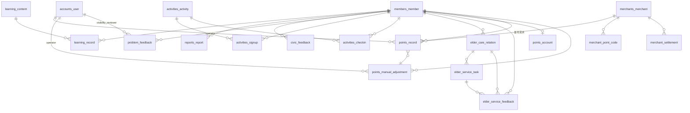

# 数据库设计文档

- 项目：街道服务数字化操作系统
- 版本：v1.0（对应代码当前状态）
- 数据库：PostgreSQL 17
- ORM：Django 5.2（Django ORM，自动迁移）
- 更新时间：2026-08-25

## 1. 概览

系统共 14 张业务表 + 1 张扩展用户表，分为以下域：

| 域 | 表 | 说明 |
| --- | --- | --- |
| 账号体系 | `accounts_user` | 后台管理员账号（继承 Django AbstractUser） |
| 用户端 | `members_member` | 小程序用户（普通用户 / 小哥） |
| 商户端 | `merchants_merchant` | 商户账号 |
| 学习宣传 | `learning_content` / `learning_record` | 学习内容与学习记录 |
| 随手拍 | `reports_report` | 随手拍上报 |
| 社情民意 | `civic_feedback` | 社情民意反馈 |
| 问题反馈 | `problem_feedback` | 问题反馈（含公开审核） |
| 活动 | `activities_activity` / `activities_signup` / `activities_checkin` | 活动、报名、签到 |
| 助老服务 | `elder_care_relation` / `elder_service_task` / `elder_service_feedback` | 小哥-老人关系、任务、反馈 |
| 积分 | `points_account` / `points_record` / `points_exchange_rule` / `points_manual_adjustment` | 账户、流水、兑换比例、人工调分 |
| 商户积分 | `merchant_point_code` / `merchant_settlement` | 固定积分码、结算 |
| 服务阵地 | `service_location` | 服务阵地（暖新驿站等） |

数据库连接默认配置（`backend/.env`）：

```env
DJANGO_DB_NAME=street
DJANGO_DB_USER=street
DJANGO_DB_PASSWORD=street
DJANGO_DB_HOST=127.0.0.1
DJANGO_DB_PORT=5432
```

## 2. 表结构明细

### 2.1 accounts_user（后台账号）

| 字段 | 类型 | 说明 |
| --- | --- | --- |
| id | bigint PK | 主键 |
| password | varchar(128) | 密码（Django hasher 加密） |
| last_login | timestamp | 最近登录时间 |
| is_superuser | bool | 是否超级用户 |
| username | varchar(150) UNIQUE | 用户名 |
| first_name / last_name | varchar(150) | 姓名 |
| email | varchar(254) | 邮箱 |
| is_staff | bool | 是否可登录后台 |
| is_active | bool | 是否启用 |
| date_joined | timestamp | 创建时间 |
| is_backend_manager | bool | 是否为后台业务管理员（自定义字段，置真时自动置 is_staff） |

### 2.2 members_member（用户）

| 字段 | 类型 | 说明 |
| --- | --- | --- |
| id | bigint PK | 主键 |
| openid | varchar(128) UNIQUE | 微信 OpenID |
| username | varchar(64) UNIQUE NULL | 用户名（账号密码登录用） |
| password | varchar(128) | 密码（可空） |
| nickname | varchar(64) | 昵称 |
| phone | varchar(20) | 手机号 |
| real_name | varchar(50) | 真实姓名 |
| identity_type | varchar(32) | 身份类型：`normal_user` 普通用户 / `courier` 小哥 |
| audit_status | varchar(20) | 审核状态：`none` 未提交 / `pending` 待审核 / `approved` 已通过 / `rejected` 已驳回 |
| audit_remark | varchar(255) | 审核说明 |
| audit_submitted_at | timestamp NULL | 最近提交审核时间 |
| is_active | bool | 是否启用 |
| created_at | timestamp | 创建时间 |

### 2.3 merchants_merchant（商户）

| 字段 | 类型 | 说明 |
| --- | --- | --- |
| id | bigint PK | 主键 |
| openid | varchar(128) UNIQUE | 商户微信 OpenID |
| username | varchar(64) UNIQUE NULL | 用户名 |
| password | varchar(128) | 密码 |
| name | varchar(100) | 商户名称 |
| contact_name | varchar(50) | 联系人 |
| phone | varchar(20) | 手机号 |
| address | varchar(255) | 经营地址 |
| latitude / longitude | float NULL | 坐标（WGS84 约等于高德坐标） |
| category_code | varchar(32) | 分类：`food` 餐饮 / `retail` 零售 / `repair` 维修 / `healthcare` 医药健康 / `life_service` 生活服务 / `other` 其他 |
| business_hours | varchar(100) | 营业时间 |
| service_content | text | 服务内容 |
| is_active | bool | 是否启用 |
| created_at | timestamp | 创建时间 |

### 2.4 learning_content（学习内容）

| 字段 | 类型 | 说明 |
| --- | --- | --- |
| id | bigint PK | 主键 |
| title | varchar(120) | 标题 |
| cover | image | 封面图 |
| image | image | 内容图片 |
| video | file | 视频文件 |
| body | text | 正文 |
| content_type | varchar(20) | `article` 图文文章 / `image` 图片内容 / `video` 视频内容 |
| points | int | 完成奖励积分 |
| required_seconds | int | 要求学习秒数（默认 60） |
| is_active | bool | 是否上架 |
| is_announcement | bool | 是否公告类型 |
| is_pinned | bool | 是否置顶公告 |
| pin_order | int NULL | 置顶顺序（唯一约束：仅当置顶时，`uniq_pin_order_when_pinned`） |
| created_at | timestamp | 创建时间 |

### 2.5 learning_record（学习记录）

| 字段 | 类型 | 说明 |
| --- | --- | --- |
| id | bigint PK | 主键 |
| member_id | FK → members_member（CASCADE） | 用户 |
| content_id | FK → learning_content（CASCADE） | 学习内容 |
| learned_seconds | int | 累计学习秒数 |
| is_completed | bool | 是否完成 |
| completed_at | timestamp NULL | 完成时间 |
| point_record_id | FK → points_record（SET NULL）NULL | 关联积分流水 |
| created_at / updated_at | timestamp | 创建 / 更新时间 |

唯一约束：`(member, content)`。

### 2.6 reports_report（随手拍）

| 字段 | 类型 | 说明 |
| --- | --- | --- |
| id | bigint PK | 主键 |
| member_id | FK → members_member（CASCADE） | 用户 |
| category_code | varchar(32) | `safety_hazard` 安全隐患 / `environmental_hygiene` 环境卫生 / `public_facility` 公共设施 / `other` 其他 / `good_deed` 爱心善举 |
| title | varchar(120) | 标题 |
| description | text | 描述 |
| image | image | 图片（单图上传兼容） |
| image_urls | json | 图片 URL 列表（多图） |
| location | varchar(255) | 位置 |
| points | int | 积分值（默认 5） |
| status | varchar(20) | `pending` 待审核 / `approved` 已通过 / `rejected` 已驳回 |
| review_comment | varchar(255) | 审核意见 |
| point_record_id | FK → points_record（SET NULL）NULL | 关联积分流水 |
| created_at / updated_at | timestamp | 创建 / 更新时间 |

### 2.7 civic_feedback（社情民意）

| 字段 | 类型 | 说明 |
| --- | --- | --- |
| id | bigint PK | 主键 |
| member_id | FK → members_member（CASCADE） | 用户 |
| title | varchar(120) | 标题 |
| content | text | 内容 |
| material_urls | json | 材料图片 URL 列表 |
| status | varchar(20) | `submitted` 已提交 / `accepted` 已采纳 / `rejected` 已驳回 |
| reply | text | 处理回复 |
| points | int | 积分值 |
| point_record_id | FK → points_record（SET NULL）NULL | 关联积分流水 |
| created_at / updated_at | timestamp | 创建 / 更新时间 |

### 2.8 problem_feedback（问题反馈）

| 字段 | 类型 | 说明 |
| --- | --- | --- |
| id | bigint PK | 主键 |
| member_id | FK → members_member（CASCADE） | 用户 |
| title | varchar(120) | 标题 |
| content | text | 内容 |
| status | varchar(20) | `submitted` 已提交 / `processing` 处理中 / `replied` 已回复 / `closed` 已关闭 |
| reply | text | 回复 |
| replied_at | timestamp NULL | 回复时间 |
| visibility_status | varchar(20) | 公开审核：`pending` 待审核 / `approved` 已公开 / `rejected` 未公开 |
| is_public | bool | 是否公开 |
| visibility_reviewer_id | FK → accounts_user（SET NULL）NULL | 公开审核人 |
| visibility_reviewed_at | timestamp NULL | 公开审核时间 |
| created_at / updated_at | timestamp | 创建 / 更新时间 |

### 2.9 activities_activity（活动）

| 字段 | 类型 | 说明 |
| --- | --- | --- |
| id | bigint PK | 主键 |
| title | varchar(120) | 标题 |
| body | text | 正文 |
| location | varchar(255) | 地点 |
| latitude / longitude | float NULL | 坐标 |
| start_time / end_time | timestamp | 开始 / 结束时间 |
| points | int | 报名签到积分值 |
| status | varchar(20) | `draft` 草稿 / `published` 已发布 / `closed` 已关闭 |
| activity_type | varchar(20) | `volunteer` 志愿任务 / `offline` 线下活动 |
| checkin_code | varchar(64) UNIQUE | 签到码（创建时自动生成 uuid4） |
| checkin_qr_image | image | 签到二维码图（自动生成） |
| created_at | timestamp | 创建时间 |

### 2.10 activities_signup（活动报名）

| 字段 | 类型 | 说明 |
| --- | --- | --- |
| id | bigint PK | 主键 |
| member_id | FK → members_member（CASCADE） | 用户 |
| activity_id | FK → activities_activity（CASCADE） | 活动 |
| created_at | timestamp | 报名时间 |

唯一约束：`(member, activity)`。

### 2.11 activities_checkin（活动签到）

| 字段 | 类型 | 说明 |
| --- | --- | --- |
| id | bigint PK | 主键 |
| member_id | FK → members_member（CASCADE） | 用户 |
| activity_id | FK → activities_activity（CASCADE） | 活动 |
| status | varchar(20) | `pending` 待确认 / `confirmed` 已确认 / `rejected` 已驳回 |
| review_comment | varchar(255) | 审核意见 |
| point_record_id | FK → points_record（SET NULL）NULL | 关联积分流水 |
| created_at / updated_at | timestamp | 签到 / 更新时间 |

唯一约束：`(member, activity)`。

### 2.12 elder_care_relation（小哥-老人关系）

| 字段 | 类型 | 说明 |
| --- | --- | --- |
| id | bigint PK | 主键 |
| member_id | FK → members_member（CASCADE） | 小哥 |
| elder_name | varchar(80) | 老人称呼 |
| elder_address | varchar(255) | 老人地址 |
| frequency | varchar(80) | 服务频次 |
| is_active | bool | 是否有效 |
| created_at / updated_at | timestamp | 创建 / 更新时间 |

约束：同一个小哥仅一条有效关系（`uniq_active_relation_per_member`）；同一老人（称呼+地址）仅一条有效关系（`uniq_active_elder`）。

### 2.13 elder_service_task（助老服务任务）

| 字段 | 类型 | 说明 |
| --- | --- | --- |
| id | bigint PK | 主键 |
| title | varchar(120) | 标题 |
| relation_id | FK → elder_care_relation（PROTECT）NULL | 对口关系 |
| description | text | 描述 |
| location | varchar(255) | 地点 |
| points | int | 积分值 |
| status | varchar(20) | `draft` 草稿 / `published` 已发布 / `closed` 已关闭 |
| created_at | timestamp | 创建时间 |

### 2.14 elder_service_feedback（助老服务反馈）

| 字段 | 类型 | 说明 |
| --- | --- | --- |
| id | bigint PK | 主键 |
| member_id | FK → members_member（CASCADE） | 用户 |
| relation_id | FK → elder_care_relation（PROTECT）NULL | 对口关系 |
| task_id | FK → elder_service_task（CASCADE）NULL | 关联任务（旧版字段） |
| elder_name / elder_address | varchar | 老人姓名 / 地址快照 |
| content | text | 反馈内容 |
| image | image | 图片 |
| image_urls | json | 图片 URL 列表 |
| points | int | 积分值 |
| status | varchar(20) | `pending` / `approved` / `rejected` |
| review_comment | varchar(255) | 审核意见 |
| reviewed_at | timestamp NULL | 审核时间 |
| point_record_id | FK → points_record（SET NULL）NULL | 关联积分流水 |
| created_at / updated_at | timestamp | 创建 / 更新时间 |

### 2.15 points_account（积分账户）

| 字段 | 类型 | 说明 |
| --- | --- | --- |
| id | bigint PK | 主键 |
| member_id | FK → members_member（CASCADE）OneToOne | 用户（一人一账户） |
| balance | int | 余额（默认 0） |

### 2.16 points_record（积分流水）

| 字段 | 类型 | 说明 |
| --- | --- | --- |
| id | bigint PK | 主键 |
| member_id | FK → members_member（CASCADE） | 用户 |
| amount | int | 变动值（收入为正、扣减为负） |
| change_type | varchar(20) | `income` 收入 / `expense` 扣减 |
| source_type | varchar(32) | `learning` 学习 / `report` 随手拍 / `activity` 活动 / `elder_service` 老人服务 / `civic_feedback` 社情民意 / `manual` 人工 / `merchant_payment` 商户积分支付 |
| source_id | varchar(64) | 来源业务 ID |
| reason | varchar(255) | 变动原因 |
| balance_after | int NULL | 变动后余额 |
| merchant_id | FK → merchants_merchant（SET NULL）NULL | 商户（支付流水） |
| yuan_amount | decimal(10,2) NULL | 折算金额 |
| request_no | varchar(64) | 请求号（幂等） |
| operator_id | FK → accounts_user（SET NULL）NULL | 操作人（人工调分） |
| created_at | timestamp | 创建时间 |

约束：同一商户下 `request_no` 唯一（`uniq_merchant_point_record_request_no`，request_no 非空时生效），用于支付幂等。

### 2.17 points_exchange_rule（积分兑换比例）

| 字段 | 类型 | 说明 |
| --- | --- | --- |
| id | bigint PK | 主键 |
| points_per_yuan | int | 每元所需积分 |
| is_active | bool | 是否启用 |
| updated_at | timestamp | 更新时间 |

### 2.18 points_manual_adjustment（人工调分）

| 字段 | 类型 | 说明 |
| --- | --- | --- |
| id | bigint PK | 主键 |
| member_id | FK → members_member（CASCADE） | 用户 |
| amount | int | 变动值（正为加分、负为扣分） |
| reason | varchar(255) | 原因 |
| operator_id | FK → accounts_user（PROTECT） | 操作人 |
| point_record_id | FK → points_record（PROTECT）OneToOne NULL | 关联流水（保存时自动生成） |
| created_at | timestamp | 创建时间 |

### 2.19 merchant_point_code（商户固定积分码）

| 字段 | 类型 | 说明 |
| --- | --- | --- |
| id | bigint PK | 主键 |
| merchant_id | FK → merchants_merchant（CASCADE） | 商户 |
| points | int | 固定积分面额 |
| code | varchar(64) UNIQUE | 二维码标识（uuid4 hex） |
| is_active | bool | 是否启用 |
| remark | varchar(255) | 备注 |
| created_at / updated_at | timestamp | 创建 / 更新时间 |

一个商户可配置多个不同面额的固定积分码。码内容格式：`street-service://merchant-point-pay?code={code}`。

### 2.20 merchant_settlement（商户结算）

| 字段 | 类型 | 说明 |
| --- | --- | --- |
| id | bigint PK | 主键 |
| merchant_id | FK → merchants_merchant（CASCADE） | 商户 |
| period_type | varchar(20) | `month` 自然月 / `custom` 自定义 |
| period_label | varchar(32) | 周期标签（如 2026-08） |
| date_from / date_to | date | 结算周期起止 |
| record_count | int | 流水数 |
| total_points | int | 总积分 |
| total_yuan_amount | decimal(12,2) | 总金额 |
| status | varchar(20) | `pending` 待处理 / `processed` 已处理 |
| processed_at | timestamp NULL | 处理时间 |
| processor_name | varchar(80) | 处理人 |
| remark | text | 备注 |
| created_at / updated_at | timestamp | 创建 / 更新时间 |

### 2.21 service_location（服务阵地）

| 字段 | 类型 | 说明 |
| --- | --- | --- |
| id | bigint PK | 主键 |
| name | varchar(100) | 名称 |
| address | varchar(200) | 地址 |
| business_hours | varchar(100) | 开放时间 |
| service_content | varchar(500) | 服务事项 |
| latitude / longitude | float NULL | 坐标 |
| is_active | bool | 是否展示 |
| created_at / updated_at | timestamp | 创建 / 更新时间 |

## 3. 表关系图



## 4. 关键设计说明

1. **积分一致性**：所有积分变动走 `points/services.py` 的 `add_points` / `deduct_points`，在数据库事务内 `SELECT ... FOR UPDATE` 锁账户后更新余额并写流水，余额与流水强一致。
2. **幂等设计**：商户积分支付（含固定码扫码）支持客户端传入 `request_no`，同商户同请求号只执行一次（`uniq_merchant_point_record_request_no` 唯一约束兜底），重复请求直接返回原流水。
3. **业务限流**：单用户单商户每日最多支付 2 次（`DAILY_MERCHANT_PAYMENT_LIMIT`），超过返回 `40003`。
4. **学习积分发放**：`learning_record` 完成（`learned_seconds >= required_seconds`）时才发放积分，且每人每内容最多一次。
5. **软删除策略**：系统统一使用 `is_active` 状态位停用（商户、用户、学习内容、固定码、服务阵地），活动/任务使用 `draft / published / closed` 状态流转，不物理删除业务数据（后台接口提供删除接口用于运营清理）。
6. **快照字段**：助老服务反馈冗余 `elder_name / elder_address` 快照，避免关系修改后历史反馈失真。
7. **隐私脱敏**：对外（商户端、公开接口）的手机号/姓名通过 `shared/privacy.py` 脱敏展示。

## 5. 迁移与初始化

```bash
cd backend
uv run python manage.py makemigrations
uv run python manage.py migrate
uv run python manage.py seed_mvp   # 开发/联调测试数据
```
