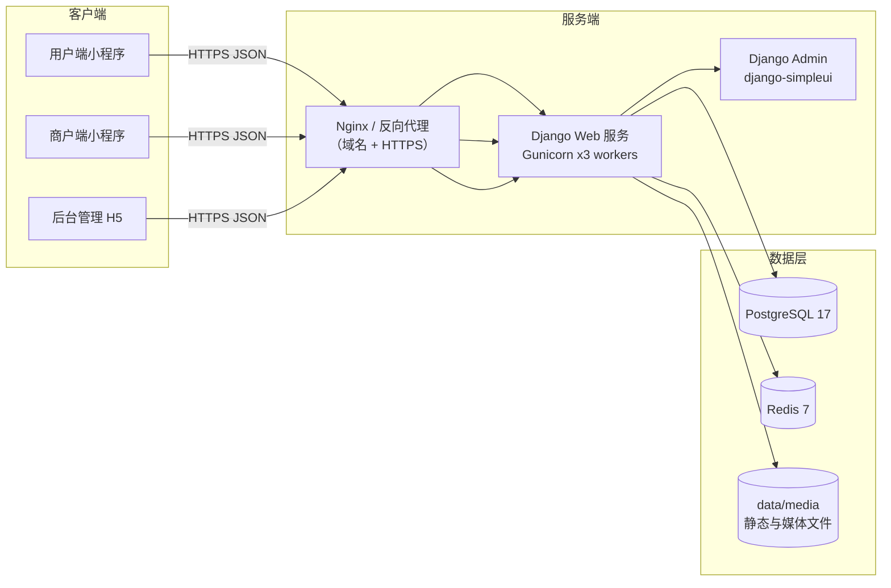
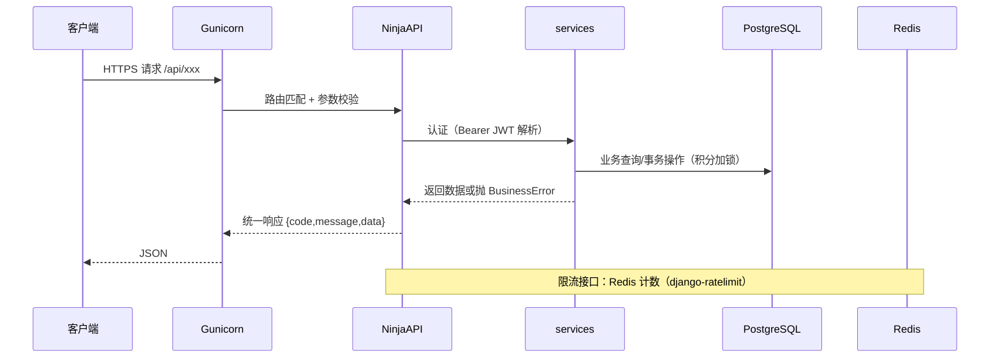
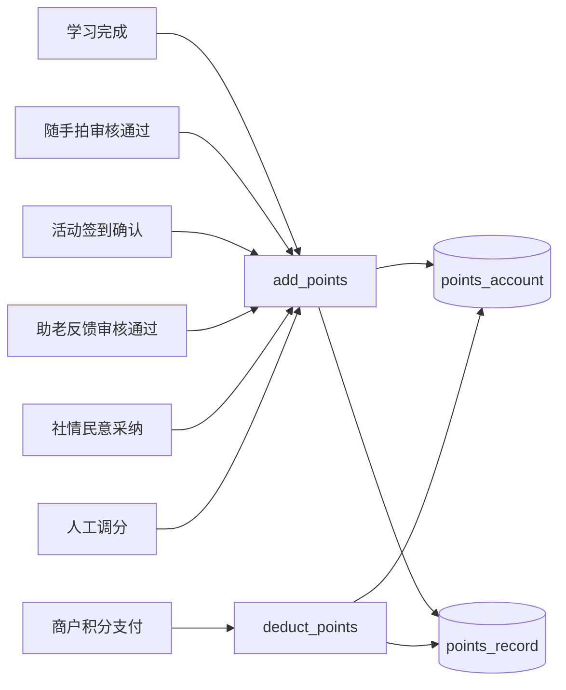
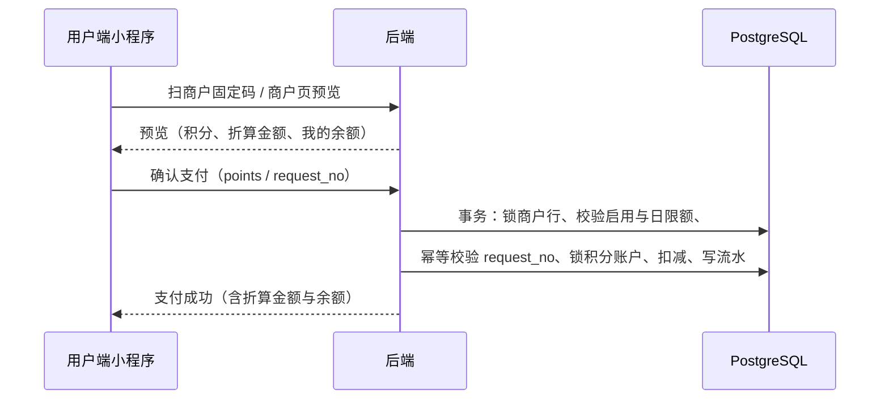

# 系统架构文档

- 项目：街道服务数字化操作系统
- 版本：v1.0
- 更新时间：2026-08-25

## 1. 系统概述

街道服务数字化操作系统面向三类终端提供服务：

1. **用户端小程序**：用户（普通居民 / 小哥）学习宣传、随手拍、活动报名签到、助老服务、积分获取与商户消费。
2. **商户端小程序**：商户登录、展示固定积分码、查看本商户积分支付流水与结算。
3. **后台管理 H5**：内容、用户、活动、审核、积分、商户、结算、服务阵地等运营管理。

后端为一期 MVP 单体应用：**Django 5.2 + Django Ninja**（REST API），部署形态为 Docker Compose（Web + PostgreSQL + Redis）。

## 2. 总体架构图



## 3. 技术栈

| 层 | 技术 | 版本 | 说明 |
| --- | --- | --- | --- |
| 语言 | Python | 3.12 | `requires-python == "==3.12.*"` |
| Web 框架 | Django | 5.2.14 | ORM、Admin、迁移 |
| API 框架 | Django Ninja | 1.6.2 | 路由、Schema 校验、自动 OpenAPI |
| 数据库 | PostgreSQL | 17.10 | 主存储 |
| 缓存 | Redis | 7.4 | Django 缓存后端（默认 cache），支持限流计数 |
| Web 服务器 | Gunicorn | >=23 | 生产 WSGI（3 workers） |
| 静态文件 | WhiteNoise | >=6.7 | collectstatic 后托管静态资源 |
| 后台 UI | django-simpleui | 2026.1.13 | Django Admin 增强（开发/应急入口） |
| 富文本 | django-tinymce | 5.0.0 | 学习内容编辑 |
| 二维码 | qrcode | 8.2 | 活动签到码、固定码生成 |
| 限流 | django-ratelimit | >=4.1 | 登录、支付、人工调分限流 |
| 依赖管理 | uv | - | 环境与依赖（uv.lock 锁定） |
| 数据库驱动 | psycopg2-binary | >=2.9.10 | - |

## 4. 后端分层

```text
backend/
├── config/                 # 项目配置与入口
│   ├── settings.py         # 环境配置（environ 读 .env）
│   ├── urls.py             # URL 路由（/api/、/admin/）
│   ├── api.py              # NinjaAPI 实例、全局异常处理、路由注册
│   ├── asgi.py / wsgi.py   # 部署入口（生产用 wsgi）
│   └── tinymce_upload.py   # Admin 富文本图片/视频上传
├── apps/                   # 业务应用（Django App）
│   ├── accounts/           # 后台账号（AUTH_USER_MODEL）
│   ├── core/               # 上传、seed 测试数据
│   ├── members/            # 用户
│   ├── learning/           # 学习宣传
│   ├── reports/            # 随手拍
│   ├── civic_feedbacks/    # 社情民意
│   ├── problem_feedbacks/  # 问题反馈
│   ├── activities/         # 活动（报名/签到/二维码）
│   ├── elder_services/     # 助老服务
│   ├── points/             # 积分账户/流水/兑换比例/人工调分
│   ├── merchants/          # 商户/固定码/结算
│   ├── service_records/    # 统一服务记录（聚合）
│   ├── service_locations/  # 服务阵地
│   └── admin_portal/       # 后台管理 API（/api/admin/*）
├── shared/                 # 跨应用公共能力
│   ├── api.py              # 统一响应 SuccessResponse/ErrorResponse
│   ├── auth.py             # HS256 JWT 签发/校验（自定义实现）
│   ├── services.py         # 认证解析 authenticate_member/merchant
│   ├── pagination.py       # 统一分页
│   ├── ratelimit.py        # 限流 key（按 token 主体或 IP）
│   ├── privacy.py          # 姓名/手机号脱敏
│   ├── media.py            # 文件绝对 URL 拼装
│   ├── wechat.py           # 微信 code2openid / 手机号（占位实现）
│   └── exceptions.py       # BusinessError 业务异常
├── data/                   # 运行时数据（media、collectstatic 输出）
└── tests/                  # 测试
```

### 4.1 分层职责

每个业务 App 内部遵循固定分层：

```text
apps/<domain>/
├── models.py    # 数据模型（表结构）
├── schemas.py   # Ninja 请求/响应 Schema
├── api.py       # 路由定义（Router）
├── services.py  # 业务逻辑（事务、积分、校验）
├── admin.py     # Django Admin 注册
└── management/commands/  # 管理命令（seed_mvp 等）
```

`api.py` 只做参数接收与错误捕获，业务逻辑全部下沉到 `services.py`，便于复用与测试。

## 5. 请求处理流程



全局异常处理（`config/api.py`）：

| 异常 | 响应 |
| --- | --- |
| `ValidationError`（Ninja 参数校验） | 400 + `40000` |
| `Http404` | 404 + `40400` |
| `BusinessError` | 对应业务码（40000/40003/40301/40101...） |
| `Ratelimited` | 429 + `42900` |
| `Exception`（兜底） | 500 + `50000`，记录日志 |

## 6. 认证与权限模型

### 6.1 Token

自定义实现 HS256 JWT（`shared/auth.py`，非第三方库），载荷：

```json
{
  "subject_type": "member | merchant | admin",
  "openid": "xxx",        // member / merchant
  "user_id": 1,           // admin
  "iat": 1724500000,
  "exp": 1724507200
}
```

有效期默认 7200 秒，由 `ACCESS_TOKEN_EXPIRES_SECONDS` 配置；签名密钥 `ACCESS_TOKEN_SECRET`（默认取 `DJANGO_SECRET_KEY`）。

### 6.2 三种主体与权限

| 主体 | 认证函数 | 校验规则 |
| --- | --- | --- |
| member | `authenticate_member` | token 主体为 member 且用户存在、启用 |
| merchant | `authenticate_merchant` | token 主体为 merchant 且商户存在、启用 |
| admin | `authenticate_admin` | token 主体为 admin 且用户存在、启用、is_staff、is_backend_manager |

部分"发布类"用户接口要求 `require_approved_member`（实名审核通过）。

### 6.3 登录方式

| 端 | 方式 | 状态 |
| --- | --- | --- |
| 用户 | 微信 code 登录 | 占位（传 openid 测试；正式登录待接入） |
| 用户 | 微信手机号授权登录 | 已实现（需配置 appid/secret） |
| 用户 | 账号密码登录 | 已实现 |
| 商户 | 微信 / 手机号 / 账号密码 | 同上 |
| 后台 | 账号密码 | 已实现 |

## 7. 核心业务架构

### 7.1 积分体系（points）



- 所有变动走 `points/services.py`，事务内 `select_for_update` 锁账户行，保证余额一致。
- 兑换比例：启用中的 `points_exchange_rule` 中 `points_per_yuan` 为每元所需积分；支付金额 = 积分 / 比例（四舍五入到分）。
- 幂等：商户支付支持 `request_no`，同商户同请求号重复请求返回原流水。
- 风控：单用户单商户每日最多支付 2 次（`DAILY_MERCHANT_PAYMENT_LIMIT`）。

### 7.2 审核流

所有"内容生产 + 积分奖励"类业务均为**提交 → 后台审核 → 发放积分**模型：

| 业务 | 提交方 | 审核动作 | 积分时机 |
| --- | --- | --- | --- |
| 用户实名 | 用户 | approve/reject | - |
| 随手拍 | 用户 | approve/reject | 审核通过 |
| 社情民意 | 用户 | accept/reject + reply | 采纳时（后台可设积分） |
| 活动签到 | 用户扫码 | confirm/reject | 确认 |
| 助老反馈 | 小哥 | approve/reject | 审核通过 |
| 问题反馈 | 用户 | 回复 + 公开审核 | - |

### 7.3 学习完成

`learning_record` 记录累计学习秒数，达到 `required_seconds` 后 `is_completed=true` 并发积分（`member, content` 唯一，防重复发放）。

### 7.4 商户积分支付



## 8. 后台管理（/api/admin）

后台为独立 API 域（`admin_portal` app），与 Django Admin（`/admin/`）并行：

- **正式运营**：走 `/api/admin/*` 业务 API（前端 H5 对接），覆盖用户、学习、活动、审核、积分、商户、结算、服务阵地等 60+ 接口。
- **Django Admin**：保留作为开发调试、数据应急排查入口（simpleui 增强界面），不作为正式运营后台。

## 9. 数据存储

| 存储 | 内容 | 位置/配置 |
| --- | --- | --- |
| PostgreSQL | 全部业务数据 | 容器内 `db` 服务，数据卷 `pg_data` |
| Redis | Django 缓存、限流计数 | 容器内 `redis` 服务，数据卷 `redis_data`，db 0 |
| 文件系统 | 上传媒体（`data/media/`）、collectstatic 输出（`data/staticfiles/`） | Web 容器内持久化（建议生产挂载卷/对象存储） |

> 注：早期版本曾使用 SQLite（`backend/data/`），现配置已迁移为 PostgreSQL；`backend/data/` 仅保留 media 等运行时文件。

## 10. 配置管理

所有配置通过环境变量（`django-environ` 读取 `backend/.env`）注入，`config/settings.py` 中带默认值：

| 环境变量 | 默认 | 说明 |
| --- | --- | --- |
| `DJANGO_SECRET_KEY` | dev-only-change-me | 密钥（生产必须修改） |
| `DJANGO_DEBUG` | true | 调试模式（生产 false） |
| `DJANGO_ALLOWED_HOSTS` | 127.0.0.1,localhost,... | 允许域名 |
| `DJANGO_DB_*` | street | PostgreSQL 连接 |
| `DJANGO_REDIS_URL` | redis://127.0.0.1:6379/0 | Redis 地址 |
| `ACCESS_TOKEN_SECRET` | =SECRET_KEY | Token 签名密钥 |
| `ACCESS_TOKEN_EXPIRES_SECONDS` | 7200 | Token 有效期 |
| `WECHAT_MINIAPP_APPID/SECRET` | 空 | 微信小程序凭证 |
| `RATELIMIT_ENABLE` | true | 是否启用限流 |

## 11. 安全设计

1. 密码使用 Django hasher（PBKDF2 等）存储，不存明文。
2. 对外接口用户手机号/姓名脱敏（`shared/privacy.py`），后台接口返回完整信息。
3. 登录接口 IP 限流（5 次/分钟）防爆破。
4. 积分扣减、支付使用数据库行锁 + 事务保证一致性；request_no 幂等防重复扣款。
5. 业务操作记录操作人（`operator` 外键），可审计。
6. 生产通过 Nginx 反向代理终止 HTTPS（`SECURE_PROXY_SSL_HEADER` 已配置）。

## 12. 可扩展性说明

当前为一期 MVP 单体架构。后续演进方向：

- 数据量增长后引入读写分离 / 消息队列（如订单、结算异步化）。
- 媒体文件迁移对象存储（OSS/COS），CDN 加速。
- 多实例部署（水平扩容 gunicorn worker / 多容器），session/cache 依赖 Redis 已具备条件。
- 微信正式登录接入后，由 `shared/wechat.py` 提供统一封装。
