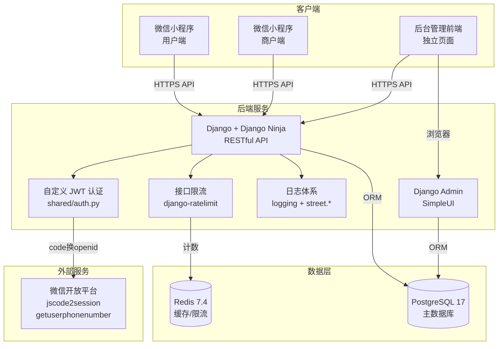
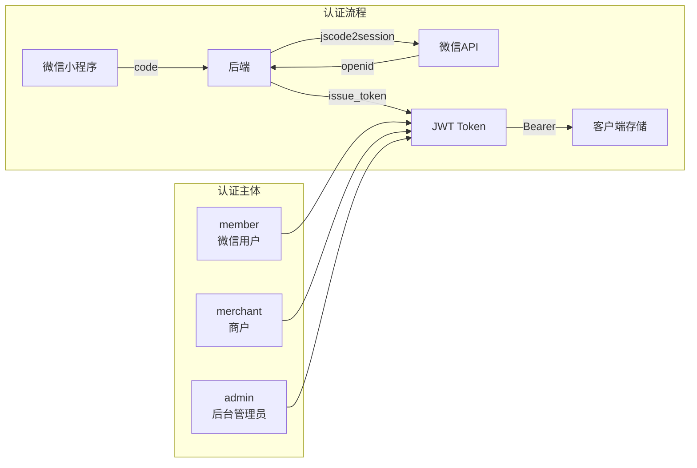
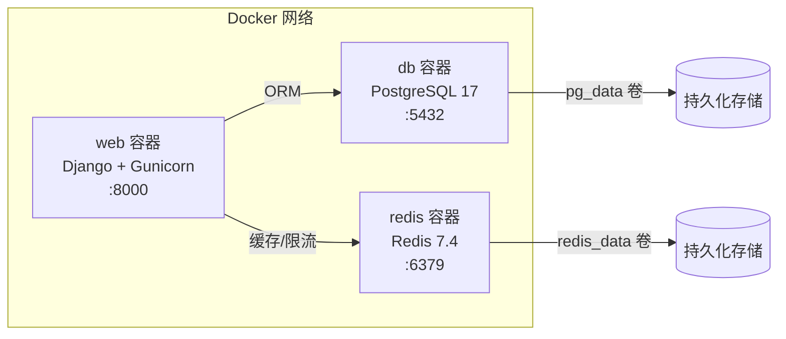

# 系统架构文档

## 1. 概述

**街道服务数字化操作系统** 是面向街道/社区场景的数字化管理平台，覆盖学习宣传、随手拍上报、活动管理、助老服务、社情民意、问题反馈、积分体系、商户积分支付等业务模块。

系统采用前后端分离架构，后端基于 Django + Django Ninja 提供 RESTful API，同时提供 Django Admin 作为后台管理调试界面。部署采用 Docker 三容器架构。

## 2. 技术栈

| 层级 | 技术 | 版本 | 说明 |
|------|------|------|------|
| 语言 | Python | 3.12 | |
| Web 框架 | Django | 5.2.14 | |
| API 框架 | Django Ninja | 1.6.2 | 基于 Pydantic 的 API 声明式框架 |
| 数据库 | PostgreSQL | 17.10 | 主数据库 |
| 缓存 | Redis | 7.4 | 限流计数、缓存后端 |
| WSGI 服务器 | Gunicorn | 23.x | 生产环境，3 workers |
| 静态文件 | WhiteNoise | 6.7+ | 静态文件服务 + 压缩 |
| 后台管理 UI | Django SimpleUI | 2026.1 | Django Admin 美化 |
| 富文本编辑器 | django-tinymce | 5.0 | 后台内容编辑 |
| 限流 | django-ratelimit | 4.1+ | 基于 Redis 的接口限流 |
| 包管理 | uv | latest | Python 依赖管理 |
| 容器化 | Docker | | 三容器编排 |

## 3. 系统架构图



## 4. 目录结构

```
backend/
├── config/                    # Django 项目配置
│   ├── settings.py            # 全局配置（数据库、缓存、限流、日志等）
│   ├── urls.py                # URL 路由（admin + api）
│   ├── api.py                 # NinjaAPI 实例 + 异常处理器 + 路由注册
│   ├── tinymce_upload.py      # TinyMCE 富文本编辑器图片/视频上传
│   ├── asgi.py                # ASGI 入口
│   └── wsgi.py                # WSGI 入口
├── apps/                      # 业务应用
│   ├── accounts/              # 后台管理员账号
│   ├── members/               # 微信用户（居民/小哥）
│   ├── learning/              # 学习宣传
│   ├── reports/               # 随手拍上报
│   ├── civic_feedbacks/       # 社情民意
│   ├── problem_feedbacks/     # 问题反馈
│   ├── activities/            # 活动管理
│   ├── elder_services/        # 助老服务
│   ├── points/                # 积分体系
│   ├── merchants/             # 商户与积分支付
│   ├── admin_portal/          # 后台管理 API（替代 Django Admin）
│   └── core/                  # 通用功能（图片上传）
├── shared/                    # 公共模块
│   ├── auth.py                # 自定义 JWT 认证（HS256）
│   ├── services.py            # 认证辅助函数
│   ├── exceptions.py          # 业务异常 BusinessError
│   ├── api.py                 # 统一响应格式
│   ├── pagination.py          # 分页工具
│   ├── ratelimit.py           # 限流键函数
│   ├── wechat.py              # 微信小程序接口对接
│   ├── media.py               # 媒体文件 URL 工具
│   └── admin.py               # Admin 权限 Mixin
├── data/                      # 运行时数据（不纳入 Git）
│   ├── media/                 # 上传文件
│   └── staticfiles/           # 收集的静态文件
├── tests/                     # 单元测试
├── Dockerfile                 # 后端镜像构建
├── docker-compose.yml         # 三容器编排
├── pyproject.toml             # Python 依赖声明
└── manage.py                  # Django 管理命令入口
```

## 5. 应用分层

每个业务应用遵循统一的文件结构：

```
apps/<app_name>/
├── models.py        # 数据模型定义
├── services.py      # 业务逻辑（事务、校验、数据组装）
├── api.py           # API 路由（Ninja Router）
├── schemas.py       # 请求/响应 Schema（Pydantic）
└── admin.py         # Django Admin 配置
```

### 分层职责

| 层级 | 职责 | 说明 |
|------|------|------|
| **API 层** (`api.py`) | 请求接收、参数校验、认证鉴权、调用 Service、返回响应 | 使用 Ninja Router 定义端点，通过 `authenticate_member` / `authenticate_merchant` / `authenticate_admin` 鉴权 |
| **Service 层** (`services.py`) | 核心业务逻辑、数据库事务、跨模型操作 | 积分变动使用 `@transaction.atomic` + `select_for_update` 保证并发安全 |
| **Model 层** (`models.py`) | 数据模型定义、字段约束、简单 save 逻辑 | 复杂业务逻辑不放在 Model 中，仅保留自动生成、状态联动等轻量逻辑 |
| **Schema 层** (`schemas.py`) | 请求参数校验、响应数据序列化 | 基于 Pydantic Schema，自动生成 OpenAPI 文档 |

## 6. 认证体系

系统采用自实现的 JWT 认证（HS256），不依赖第三方 JWT 库。支持三种主体类型：



| 主体 | 登录方式 | Token 签发 | 鉴权函数 |
|------|----------|------------|----------|
| member | 微信小程序 `code` 换 openid | `issue_token(subject_type="member", openid=...)` | `authenticate_member` / `require_approved_member` |
| merchant | 微信小程序 `code` 换 openid | `issue_token(subject_type="merchant", openid=...)` | `authenticate_merchant` |
| admin | 用户名 + 密码 | `issue_admin_token(user_id=...)` | `authenticate_admin` |

### 鉴权层级

- **基础鉴权** `authenticate_member`：验证 token 有效 + 用户 is_active
- **审核鉴权** `require_approved_member`：在基础鉴权上额外要求 `audit_status = approved`，用于提交类接口（上报、反馈等）
- **管理员鉴权** `authenticate_admin`：验证 token 为 admin 主体 + 用户 is_active + is_staff + is_backend_manager

## 7. API 路由

所有 API 统一挂载在 `/api/` 下，通过 NinjaAPI 实例注册 Router：

| 路由前缀 | 模块 | 说明 |
|----------|------|------|
| `/api/auth` | members.auth_router | 用户认证（微信登录） |
| `/api/admin/auth` | admin_portal.auth_router | 后台管理员认证 |
| `/api/admin` | admin_portal.router | 后台管理全部接口（60+ 端点） |
| `/api/uploads` | core.router | 通用图片上传 |
| `/api/members` | members.router | 用户信息与资料 |
| `/api/learning` | learning.router | 学习内容与记录 |
| `/api/reports` | reports.router | 随手拍上报 |
| `/api/civic-feedbacks` | civic_feedbacks.router | 社情民意 |
| `/api/problem-feedbacks` | problem_feedbacks.router | 问题反馈 |
| `/api/activities` | activities.router | 活动报名与签到 |
| `/api/elder-services` | elder_services.router | 老人服务 |
| `/api/points` | points.router | 积分余额与流水 |
| `/api/merchants` | merchants.public_merchant_router | 商户列表与积分支付（用户端） |
| `/api/merchant/auth` | merchants.merchant_auth_router | 商户认证 |
| `/api/merchant` | merchants.merchant_router | 商户信息与流水（商户端） |

### 统一响应格式

```json
// 成功
{ "code": 0, "message": "success", "data": { ... } }

// 分页
{ "code": 0, "message": "success", "data": { "items": [...], "total": 100, "page": 1, "page_size": 20 } }

// 错误
{ "code": 40000, "message": "请求参数错误", "errors": { ... } }
```

### 异常处理

| 异常类型 | HTTP 状态码 | 业务码 | 处理位置 |
|----------|-------------|--------|----------|
| 参数校验错误 | 400 | 40000 | `ValidationError` handler |
| 业务异常 | 400/403 | 自定义 | `BusinessError` handler |
| 未认证 | 401 | 40101/40102 | `BusinessError` handler |
| 无权限 | 403 | 40301 | `BusinessError` handler |
| 资源不存在 | 404 | 40400 | `Http404` handler |
| 限流 | 429 | 42900 | `Ratelimited` handler |
| 服务器内部错误 | 500 | 50000 | `Exception` catch-all |

## 8. 接口限流

基于 `django-ratelimit` 装饰器 + Redis 计数实现，分两档策略：

| 等级 | 适用端点 | 限流阈值 | 限流键 | 目的 |
|------|----------|----------|--------|------|
| P0 | 登录类（管理员登录、微信登录、手机号登录） | 5 次/分钟 | 客户端 IP | 防暴力撞库 |
| P1 | 支付/积分类（积分支付、固定码扫码、人工调分） | 20 次/分钟 | 用户身份 | 防重复提交刷积分 |

**限流键策略**（`shared/ratelimit.py` 的 `user_key` 函数）：

- 认证用户：`{subject_type}:{openid 或 user_id}`（如 `member:abc123`、`admin:1`）
- 认证失败兜底：`ip:{客户端IP}`

**环境开关**：`RATELIMIT_ENABLE` 在测试环境（`TESTING`）自动设为 `False`，不影响单元测试。

## 9. 日志体系

基于 Python `logging` + Django `LOGGING` 配置：

| Logger | 级别 | 覆盖范围 |
|--------|------|----------|
| `street` | INFO | 所有业务日志 |
| `street.api` | WARNING | 全局异常、限流触发 |
| `street.auth` | WARNING | Token 解析失败 |
| `street.wechat` | ERROR/WARNING | 微信接口异常 |
| `street.points` | INFO | 积分增减流水 |
| `street.merchants` | INFO | 商户支付流水 |
| `django.request` | WARNING | Django 请求异常 |

日志输出至控制台（StreamHandler），格式：`[时间] 级别 logger名 消息`。容器部署时通过 `docker logs` 查看。

## 10. 部署架构

### Docker 三容器



### Dockerfile

- 基础镜像：`python:3.12-slim`
- 安装 `uv` 进行依赖管理，`uv sync --frozen --no-dev` 安装生产依赖
- `collectstatic` 收集静态文件
- 运行命令：`gunicorn config.wsgi:application --bind 0.0.0.0:8000 --workers 3`

### docker-compose 编排

| 服务 | 镜像 | 端口 | 依赖 | 健康检查 |
|------|------|------|------|----------|
| `db` | postgres:17.10-alpine | 5432 | - | `pg_isready -U street` |
| `redis` | redis:7.4-alpine | 6379 | - | `redis-cli ping` |
| `web` | 本地构建 | 8000 | db (healthy) + redis (healthy) | - |

数据持久化通过 Docker named volumes（`pg_data`、`redis_data`）。

### 环境配置

通过 `.env` 文件注入环境变量，`.env.example` 提供模板。关键配置项：

| 配置项 | 说明 | 默认值 |
|--------|------|--------|
| `DJANGO_SECRET_KEY` | Django 密钥 | dev-only-change-me |
| `DJANGO_DEBUG` | 调试模式 | true |
| `DJANGO_DB_HOST` | 数据库主机 | 127.0.0.1 |
| `DJANGO_REDIS_URL` | Redis 连接地址 | redis://127.0.0.1:6379/0 |
| `RATELIMIT_ENABLE` | 限流开关 | true |
| `WECHAT_MINIAPP_APPID` | 微信小程序 AppID | - |
| `WECHAT_MINIAPP_SECRET` | 微信小程序 Secret | - |
| `ACCESS_TOKEN_EXPIRES_SECONDS` | Token 有效期 | 7200（2小时） |

## 11. 缓存策略

| 环境 | 缓存后端 | 说明 |
|------|----------|------|
| 生产 | Redis (`redis://redis:6379/0`) | 限流计数 + 通用缓存 |
| 测试 | LocMemCache | 内存缓存，无需 Redis 依赖 |

通过 `TESTING`（检测 `sys.argv` 中是否含 `"test"`）自动切换，测试环境同时关闭限流。
